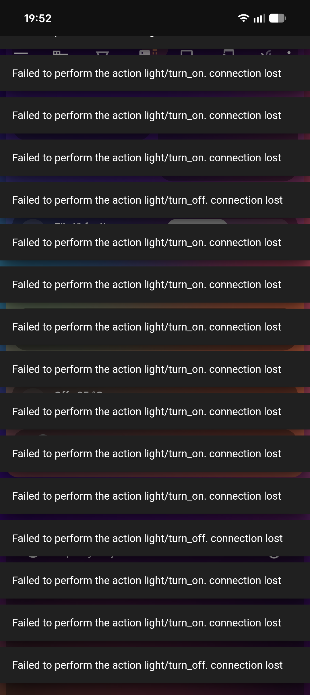
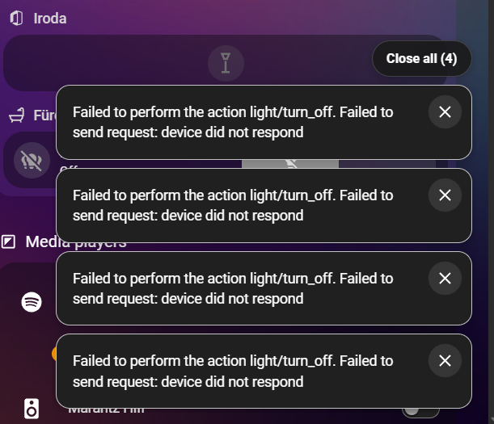

# HA Toast Stack


The release includes the matching cyan notification-stack icon in 256 px and 512 px sizes. HACS downloads the icon assets alongside the module. HACS 2.0.5 does not automatically display arbitrary repository icons for Dashboard plugins; the icon is shown here in the documentation and available as an asset, not a new integration icon.

[Magyar leírás](README.hu.md)

## Why this exists

This project started when repeated connection errors filled the entire Home Assistant screen with large toast notifications, covering the dashboard. HA Toast Stack keeps them in a compact, scrollable stack with individual close buttons and a **Close all** badge.

| Before | After |
| --- | --- |
|  |  |

Compact Home Assistant toast notifications with a circular close button and a **Close all** badge when two or more notifications are displayed.

- Bottom-right stack, up to 420 px wide, with margins on mobile.
- Scrollable stack limited to 45% of the viewport height, without visible scrollbars.
- A circular X in the upper-right corner of every toast.
- Sticky **Close all (count)** badge above multiple notifications.
- Native Home Assistant actions, timeouts and dismiss callbacks are preserved.
- New notifications arriving during Close all remain visible.
- Separate CSS file for appearance changes.

## Install with HACS

1. Open **HACS → ⋮ → Custom repositories**.
2. Add `https://github.com/kbalint/ha_toast_stack` and select **Dashboard** (called **Lovelace** or **Plugin** in older HACS versions).
3. Find **HA Toast Stack** and download it. HACS installs both files under `/config/www/community/ha_toast_stack/`.
4. Add the module to the existing `frontend:` block in `configuration.yaml`:

```yaml
frontend:
  extra_module_url:
    - /local/community/ha_toast_stack/ha_toast_stack.js?v=5
```

5. Restart Home Assistant, then fully reload your browser or Companion app.

If `extra_module_url` already exists, append the new list item. If `frontend` is included from another YAML file, add the setting there. Do not create a second `frontend:` key.

HACS may also register a dashboard resource automatically. Loading through `frontend.extra_module_url` makes the override available throughout the frontend, including when you open a non-dashboard page first. Duplicate loading is guarded. When migrating from a manual install, replace the old `/local/ha-toast-stack/...` module entry with the HACS path.

This repository is installed as a **custom repository**; it is not listed in the default HACS catalog. HACS handles file downloads and updates; the YAML setting is added once manually.

## Manual installation

Copy the root `ha-toast-stack.js` and `ha-toast-stack.css` files into `/config/www/ha-toast-stack/`, then use:

```yaml
frontend:
  extra_module_url:
    - /local/ha-toast-stack/ha-toast-stack.js?v=5
```

Restart Home Assistant and fully reload your client.

## Updates and customization

Every push to `main` automatically builds, checks and publishes a versioned GitHub release with the JavaScript and CSS assets. HACS discovers new releases during its periodic update checks and shows an available update. This is an update indicator; push notifications to your phone require a Home Assistant automation based on the HACS update entity. You can also refresh repository information manually to discover a release sooner.

Download updates through HACS, then increase the `?v=5` value in the module URL and reload your client. Restart Home Assistant after changing YAML. The loader passes the module query string to the CSS URL as well to invalidate both caches.

Edit the CSS beside the installed module to customize the appearance. HACS updates overwrite installed files, so back up your customizations before updating.

## Compatibility

Requires the `.stack` / `ha-toast` notification manager introduced in Home Assistant 2026.8. It uses frontend internals, so future Home Assistant changes may require an update. Packaging and close-all behavior have been checked locally; installation through a live HACS instance has not been tested.

The JavaScript injects CSS into the components' shadow roots and enables the native dismiss buttons. A global CSS stylesheet alone cannot reach those components. Existing notifications gain dismiss buttons the next time they are shown.

## Uninstall

Remove the module entry from `frontend.extra_module_url`, uninstall the repository in HACS (or delete the manually installed files), restart Home Assistant and fully reload your client.

## Development

Edit the root JS/CSS sources, run `node build.cjs`, and commit both source files and `dist/`. Pushing to `main` triggers `.github/workflows/release.yml`, which validates the distribution and publishes both assets. HACS can download the published release or the contents of `dist/`; manual installation uses the root files.

## References

- [HACS frontend repository packaging](https://www.hacs.dev/docs/publish/plugin/)
- [Home Assistant extra JavaScript modules](https://www.home-assistant.io/integrations/frontend/#loading-extra-javascript)
- [Notification manager source](https://github.com/home-assistant/frontend/blob/dev/src/managers/notification-manager.ts)
- [Toast component source](https://github.com/home-assistant/frontend/blob/dev/src/components/ha-toast.ts)
